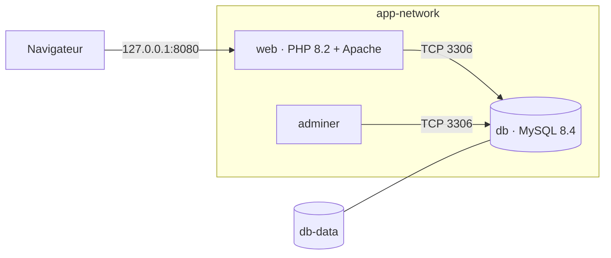

# Articles

Application PHP de gestion d’articles, servie par Apache et persistée dans MySQL. Trois conteneurs tournent sur le réseau `app-network` : `web`, `db` et Adminer.

Images publiées :

- [clemlmd/articles-web](https://hub.docker.com/r/clemlmd/articles-web)
- [clemlmd/articles-db](https://hub.docker.com/r/clemlmd/articles-db)

Le détail de l’architecture est dans [docs/architecture.md](docs/architecture.md).



## Prérequis

- Docker Engine avec Compose v2
- Les ports `8080` et `8081` libres sur la machine

## Déploiement

```bash
git clone https://github.com/ClementLmd/dev-docker-projet-final.git
cd dev-docker-projet-final
cp .env.example .env
docker compose up -d --build --wait
```

La première initialisation de MySQL peut prendre une minute. `--wait` rend la main quand `web` et `db` sont healthy.

- Application : http://127.0.0.1:8080/
- Adminer : http://127.0.0.1:8081/ (serveur `db`, utilisateur `test`, base `test`)

Arrêt des conteneurs, le volume de données est conservé :

```bash
docker compose down
```

Suppression du volume, et donc des articles :

```bash
docker compose down -v
```

## Variables d’environnement

Les valeurs locales sont dans `.env.example`. Le fichier `.env` n’est pas versionné. `DB_PASS`, `MYSQL_ROOT_PASSWORD` et `MYSQL_PASSWORD` sont obligatoires : Compose refuse de démarrer s’ils manquent.

| Variable | Rôle |
| --- | --- |
| `APP_PORT` | Port de l’application sur la machine. Défaut `8080`. |
| `DB_HOST` | Nom du service MySQL vu par PHP. Valeur `db`. |
| `DB_PORT` | Port MySQL dans le réseau Compose. Valeur `3306`. |
| `DB_NAME` | Base lue par PHP. Doit être identique à `MYSQL_DATABASE`. |
| `DB_USER` | Compte PHP. Doit être identique à `MYSQL_USER`. |
| `DB_PASS` | Mot de passe PHP. Doit être identique à `MYSQL_PASSWORD`. |
| `MYSQL_ROOT_PASSWORD` | Mot de passe root créé au premier démarrage de MySQL. |
| `MYSQL_DATABASE` | Base créée par l’image MySQL. |
| `MYSQL_USER` | Compte applicatif créé par l’image MySQL. |
| `MYSQL_PASSWORD` | Mot de passe de ce compte. |

`DB_NAME`, `DB_USER` et `DB_PASS` doivent rester alignés avec `MYSQL_DATABASE`, `MYSQL_USER` et `MYSQL_PASSWORD`.

## Procédure de test

1. Ouvrir http://127.0.0.1:8080/. La page Articles s’affiche, sans message `ERREUR`.
2. Ajouter un article par le formulaire. Il apparaît dans la liste.
3. Ouvrir Adminer et vérifier la ligne dans la table `articles`.
4. Lancer `docker compose down`, puis `docker compose up -d --wait`. L’article est toujours là.
5. Depuis le conteneur web :

```bash
docker exec web ping -c 3 db
docker exec web curl -v --max-time 5 http://db:3306
```

`ping` doit recevoir les trois réponses. `curl` ouvre le port 3306 puis s’arrête sur `Received HTTP/0.9 when not allowed` : MySQL parle son propre protocole, pas HTTP. La connexion TCP est bien établie.
