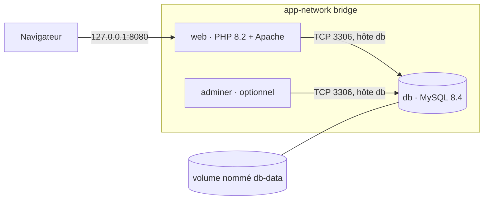

# Architecture

Application PHP de gestion d’articles, conteneurisée en deux services obligatoires sur un réseau bridge dédié. Les mots de passe ne sont pas écrits dans les Dockerfiles : ils viennent du fichier `.env` (modèle : `.env.example`).

## Services

| Service | Rôle | Image | Publication |
| --- | --- | --- | --- |
| `web` | Pages PHP (liste et ajout d’articles) servies par Apache | `php:8.2-apache` | `127.0.0.1:8080` vers le port 80 du conteneur |
| `db` | Persistance MySQL de la table `articles` | `mysql:8.4` (tag épinglé, pas `latest`) | Aucun port sur l’hôte. Accessible uniquement sous le nom `db` sur le réseau Compose |
| `adminer` | Administration SQL, optionnelle | `adminer` | `127.0.0.1:8081` |

PHP avec Apache plutôt que Nginx + PHP-FPM : l’application est un petit site de fichiers PHP, sans build d’assets. Apache sert le `DocumentRoot` sur le port 80 et évite un troisième processus.

## Schéma

## Réseau

Un seul réseau bridge personnalisé, `app-network`.

- `web` joint MySQL par le nom de service `db`, pas par `localhost` et pas par une IP fixe.
- MySQL n’est pas publié sur la machine hôte : seul un conteneur du réseau peut ouvrir le port 3306.
- Le réseau par défaut de Compose isolerait déjà cette stack. Un réseau nommé rend la topologie explicite dans `docker network ls`.

## Volume

Volume nommé `db-data`, monté sur `/var/lib/mysql`.

Il survit à `docker compose down` (sans l’option `-v`). C’est ce qui garde les articles après l’arrêt des conteneurs. Le code PHP et le script SQL ne sont pas des données : ils sont copiés dans l’image ou montés au démarrage, pas dans ce volume.

## Variables d’environnement

| Variable | Consommateur | Valeur locale |
| --- | --- | --- |
| `APP_PORT` | Publication du service `web` | `8080` |
| `DB_HOST` | PHP | `db` |
| `DB_PORT` | PHP | `3306` |
| `DB_NAME` | PHP | `test` |
| `DB_USER` | PHP | `test` |
| `DB_PASS` | PHP | `test` |
| `MYSQL_DATABASE` | Entrypoint MySQL | `test` |
| `MYSQL_USER` / `MYSQL_PASSWORD` | Entrypoint MySQL, compte applicatif | `test` / `test` |
| `MYSQL_ROOT_PASSWORD` | Entrypoint MySQL | mot de passe root local |

`DB_*` et `MYSQL_USER` / `MYSQL_PASSWORD` / `MYSQL_DATABASE` doivent rester alignés : PHP se connecte avec le compte créé par l’image MySQL.

## Connexion applicative

`db-config.php` lit `DB_HOST`, `DB_NAME`, `DB_USER` et `DB_PASS`. Dans le conteneur `web`, `localhost` désigne ce conteneur, pas MySQL : l’hôte est donc le nom de service `db`.

L’image MySQL crée la base et le compte applicatif à partir de `MYSQL_DATABASE`, `MYSQL_USER` et `MYSQL_PASSWORD`. Ce compte accepte les connexions des autres conteneurs du réseau. Le script `articles.sql`, monté dans `/docker-entrypoint-initdb.d/`, ne crée que la table `articles`.
